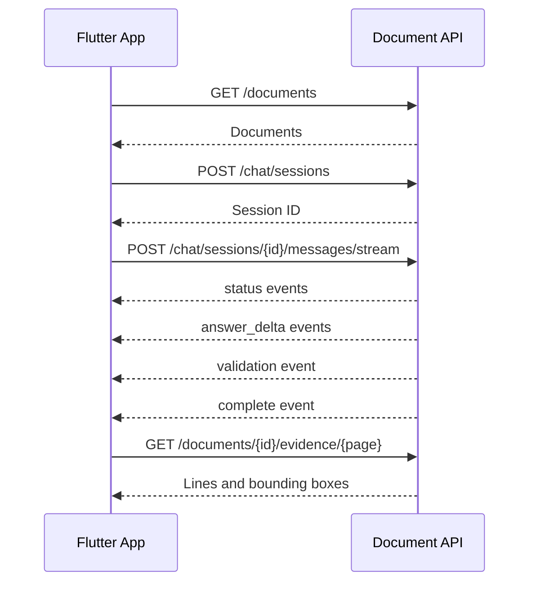

# Flutter API Integration

The API supports document upload and selection, conversational follow-up
questions, SSE streaming, verified citations, and source highlighting. Sessions
are held in memory and disappear when the Python process restarts.

Every endpoint requires:

```http
Authorization: Bearer YOUR_APP_TOKEN
```

FastAPI reads the token from `DOCUMENT_INTELLIGENCE_API_KEY`. Flutter receives
it through `--dart-define`; it is not hard-coded into Dart source.

## Development URLs

| Target           | Base URL                           |
| ---------------- | ---------------------------------- |
| Android emulator | `http://10.0.2.2:8000`             |
| iOS simulator    | `http://127.0.0.1:8000`            |
| Flutter Web      | `http://127.0.0.1:8000`            |
| Physical device  | `http://YOUR_COMPUTER_LAN_IP:8000` |

```bash
uv run python -m uvicorn document_intelligence.api:app \
  --host 0.0.0.0 \
  --port 8000
```

Run Flutter on an Android emulator:

```bash
cd /home/sumeet/Desktop/documentintelligence
flutter run --dart-define=API_TOKEN=local-document-app-dev-key
```

For a physical device:

```bash
flutter run \
  --dart-define=API_BASE_URL=http://YOUR_COMPUTER_LAN_IP:8000 \
  --dart-define=API_TOKEN=local-document-app-dev-key
```

Configure Flutter Web origins when necessary:

```dotenv
DOCUMENT_INTELLIGENCE_CORS_ORIGINS=http://localhost:8080,http://localhost:3000
```

## App Flow



## Documents

### List selectable documents

```http
GET /documents
```

### Upload and index a PDF

```http
POST /documents
Content-Type: multipart/form-data
```

Use multipart field `file`. The endpoint currently indexes synchronously. The
source PDF is retained locally so it can be displayed later.

### Metadata and readiness

```http
GET /documents/{doc_id}
```

Only enable selection when `status` is `completed` and `retrievalReady` is true.

### Document outline

```http
GET /documents/{doc_id}/structure
```

### Structured page evidence

```http
GET /documents/{doc_id}/evidence/{page_number}
```

```json
{
  "document": "report.pdf",
  "doc_id": "pi-example",
  "page": 12,
  "lines": [
    {
      "line": 8,
      "text": "Revenue increased by 12%.",
      "bbox": [24.0, 130.2, 558.4, 144.9]
    }
  ]
}
```

### Source PDF

```http
GET /documents/{doc_id}/file
```

This returns `application/pdf`. To display a citation, open its `page` and map
its `bounding_boxes` from PDF coordinates into the viewer's rendered page.

## Chat Session Lifecycle

### Create a session

```http
POST /chat/sessions
Content-Type: application/json

{"document_ids":["pi-first","pi-second"]}
```

The API validates every selected document before creating the session.

### Read a session

```http
GET /chat/sessions/{session_id}
```

Returns document scope, recent history, timestamps, and `busy` state.

### Change selected documents

```http
PUT /chat/sessions/{session_id}/documents
Content-Type: application/json

{"document_ids":["pi-other"]}
```

Changing scope clears conversation history to prevent context leakage.

### Delete a session

```http
DELETE /chat/sessions/{session_id}
```

Returns HTTP `204`.

## Messages

### Normal JSON response

```http
POST /chat/sessions/{session_id}/messages
Content-Type: application/json

{"message":"Compare the risks.","reasoning_effort":"medium"}
```

### Streaming SSE response

```http
POST /chat/sessions/{session_id}/messages/stream
Accept: text/event-stream
Content-Type: application/json

{"message":"Compare the risks.","reasoning_effort":"medium"}
```

Events arrive in this order:

1. `status` with stage `scope`
2. `status` with stage `retrieval`
3. `status` with stage `evidence` and selected pages
4. `status` with stage `generation`
5. One or more `answer_delta` events
6. `status` with stage `validation`
7. `validation`
8. `complete` with the canonical answer, citations, boxes, and usage

```text
event: answer_delta
data: {"type":"answer_delta","stage":"generation","delta":"Revenue "}
```

Display deltas as an unverified draft. Mark the answer verified only after the
`validation` event, and reconcile the accumulated text with `complete.data`.
An `error` event means the turn failed and may be retried. Only one message may
run per session; concurrent requests receive HTTP `409`.

Flutter's `http` package can consume the response body:

```dart
final request = http.Request(
  'POST',
  Uri.parse('$baseUrl/chat/sessions/$sessionId/messages/stream'),
)
  ..headers['Accept'] = 'text/event-stream'
  ..headers['Content-Type'] = 'application/json'
  ..body = jsonEncode({
    'message': message,
    'reasoning_effort': 'medium',
  });

final response = await http.Client().send(request);
final lines = response.stream
    .transform(utf8.decoder)
    .transform(const LineSplitter());
```

Parse frames on blank lines. Keep the current `event:` name and concatenate
`data:` lines before JSON decoding.

## Stateless Operations

Use `POST /queries` for one-off questions without conversation context. Use
`POST /extractions` for evidence-backed JSON extraction.

## Status Codes

| Status | Meaning                                                    |
| ------ | ---------------------------------------------------------- |
| `401`  | Application token is missing or invalid                    |
| `404`  | Session, document, evidence page, or source PDF not found  |
| `409`  | Document not ready or session already processing a message |
| `413`  | Upload exceeds configured size limit                       |
| `415`  | File is not a PDF                                          |
| `422`  | Retrieval, extraction, or citation validation failed       |

## Current Limits

- Sessions are process-local and disappear on restart.
- Use one Uvicorn worker so all requests see the same sessions.
- Upload indexing is synchronous.
- A development bearer token is required; user isolation is not implemented.
- HTTPS is required outside a trusted development network.

A native Flutter app cannot keep a static token secret, and Android package or
iOS bundle identifiers are not authentication. For production, add user
authentication and validate Play Integrity on Android plus App Attest or
DeviceCheck on iOS before issuing short-lived API tokens. CORS only restricts
browsers and does not secure native mobile traffic.
