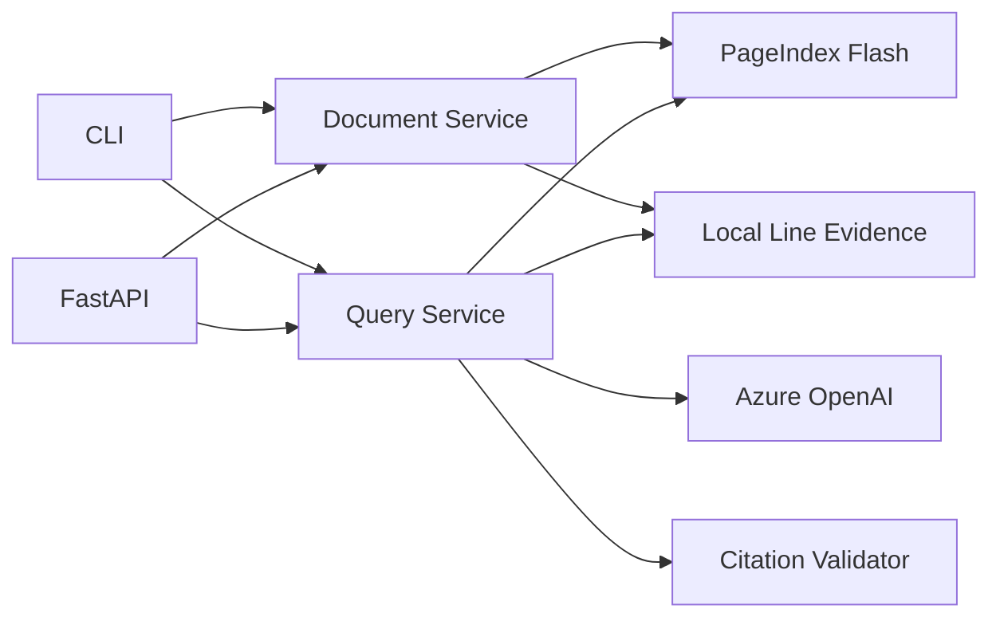

# Document Intelligence Implementation

## Goal

Build a local-first document intelligence service around PageIndex Flash with
traceable evidence. The system uses PageIndex for hierarchical document
retrieval, PyMuPDF for line and bounding-box extraction, and Azure OpenAI for
grounded answer generation.

Persistent application storage, user accounts, durable jobs, and deployment
infrastructure are intentionally outside the current phase.

## Architecture



### Modules

| Module                               | Responsibility                                                         |
| ------------------------------------ | ---------------------------------------------------------------------- |
| `src/document_intelligence/config.py`    | Environment validation and runtime paths                               |
| `src/document_intelligence/models.py`    | Typed documents, evidence, citations, queries, and extraction results  |
| `src/document_intelligence/providers.py` | PageIndex and Azure OpenAI client construction                         |
| `src/document_intelligence/evidence.py`  | PDF hashing, numbered line extraction, bounding boxes, atomic sidecars |
| `src/document_intelligence/citations.py` | Page selection parsing, evidence rendering, citation validation        |
| `src/document_intelligence/services.py`  | Indexing, retrieval, grounded QA, and structured extraction workflows  |
| `src/document_intelligence/cli.py`       | Terminal interface and compatibility commands                          |
| `src/document_intelligence/api.py`       | HTTP upload, inspection, query, and extraction endpoints               |
| `main.py`                            | Stable CLI entry point                                                 |

## Implemented Workflows

### Indexing

1. Validate that the input is a PDF.
2. Compute SHA-256 for duplicate detection.
3. Reuse a matching PageIndex document unless `--force` is used.
4. Build the PageIndex Flash tree.
5. Extract local ordered lines and bounding boxes with PyMuPDF.
6. Atomically write the evidence sidecar under `.pageindex/line-index/`.

### Grounded Question Answering

1. PageIndex reasons over the tree and identifies relevant pages.
2. The service loads only those pages from the local line evidence.
3. Azure OpenAI answers with mandatory document/page/line citations.
4. The validator rejects unknown documents, pages outside supplied evidence,
   missing citations, and out-of-range lines.
5. JSON responses resolve citations to exact source text and bounding boxes.

Interactive chat emits explicit `scope`, `retrieval`, `evidence`, `generation`,
and `validation` stages. Azure answer deltas are printed immediately as a draft;
the CLI marks completion as verified only after citation validation succeeds.
Recent turns are carried in memory for contextual follow-up questions, but are
not persisted between processes.

Location validation proves that cited source locations exist and were supplied
to the model. It does not prove logical entailment between every claim and its
source. That requires the verification phase described below.

### Multi-Document Analysis

The query service accepts multiple document IDs. PageIndex chooses relevant
pages across the selected set, while citation validation keeps each evidence
range bound to its original document.

### Structured Extraction

The `extract` command and `/extractions` endpoint request a JSON object from the
grounded workflow and return the validated citations separately. Production
schemas should be represented by dedicated Pydantic models rather than arbitrary
instructions.

## HTTP API

| Method | Path                           | Purpose                              |
| ------ | ------------------------------ | ------------------------------------ |
| `GET`  | `/health`                      | Process health                       |
| `POST` | `/documents`                   | Upload and synchronously index a PDF |
| `GET`  | `/documents`                   | List PageIndex documents             |
| `GET`  | `/documents/{id}`              | Metadata and retrieval readiness     |
| `GET`  | `/documents/{id}/structure`    | Hierarchical tree                    |
| `GET`  | `/documents/{id}/pages/{spec}` | Numbered local evidence              |
| `POST` | `/queries`                     | Verified line-cited QA               |
| `POST` | `/extractions`                 | Evidence-backed JSON extraction      |

Blocking PageIndex and Azure SDK calls run in FastAPI's thread pool. Uploads are
streamed with a configurable size limit and preserve the original filename.

## Running

```bash
uv sync
uv run python main.py index ./test.pdf
uv run python main.py ask DOC_ID "Summarize the document" --json
uv run python main.py extract DOC_ID "Extract education and work history"
uv run fastapi dev document_intelligence/api.py
```

OpenAPI documentation is available at `http://127.0.0.1:8000/docs`.

## Production Roadmap

### Next: Claim Entailment Verification

Split answers into claims, associate each claim with citations, and classify each
claim as `supported`, `partially_supported`, or `unsupported`. Reject or
regenerate unsupported claims. Track a prompt version and verifier model so
evaluations remain reproducible.

### OCR and Image Understanding

Detect pages with insufficient selectable text. Route only those pages through
an OCR adapter such as Docling or PaddleOCR, normalize its output to the same
line/bounding-box model, and mark the extraction source on every page.

### Tables

Introduce table, row, column, cell, and footnote models. Preserve coordinates and
headers rather than flattening tables into prose. Citation responses should be
able to point to both lines and cells.

### Evaluation

Maintain versioned question sets with expected answers and expected evidence.
Measure answer correctness, citation precision/recall, unsupported claim rate,
latency, and token usage. Run this suite before changing models or prompts.

### Citation Viewer

Use citation bounding boxes to highlight source regions in a PDF viewer. A user
must be able to select a citation, see the exact evidence, and return to the
answer without losing context.

### Deferred With Storage

The following require an explicit storage and deployment decision and are not
implemented in this phase:

- Durable background jobs and retries
- Conversation history
- Query and model audit logs
- Collections, tags, permissions, and user accounts
- Local full-text or semantic corpus search
- Saved extraction schemas and version history

## Security And Reliability

- Treat document text as untrusted input and ignore instructions embedded in it.
- Keep provider credentials in environment variables; never put them in uploads
  or API responses.
- Apply reverse-proxy authentication, TLS, request limits, and rate limiting
  before exposing the API outside a trusted network.
- Run arbitrary uploaded PDFs in an isolated worker for a public deployment.
- Do not represent `location_verified` as factual or legal verification.
