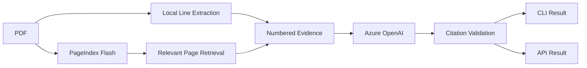

# Document Intelligence Feature Catalog

This document is the single feature inventory for the project. It distinguishes
working behavior from planned work so product claims stay aligned with the code.

## Status Legend

| Status      | Meaning                                                                    |
| ----------- | -------------------------------------------------------------------------- |
| Implemented | Available and covered by executable validation                             |
| Partial     | Useful implementation exists, but important production behavior is missing |
| Planned     | Defined next step with a known implementation direction                    |
| Deferred    | Intentionally excluded from the current stateless phase                    |

## Current Product

The application is a local-first document intelligence system for text-based
PDFs. PageIndex Flash builds hierarchical document indexes, PyMuPDF creates
numbered line evidence with PDF coordinates, and Azure OpenAI produces grounded
answers and structured extractions.



## Feature Matrix

### Document Ingestion

| Feature                         | Status      | Notes                                                  |
| ------------------------------- | ----------- | ------------------------------------------------------ |
| Text-based PDF ingestion        | Implemented | PageIndex Flash currently accepts PDFs                 |
| Local tree indexing             | Implemented | Indexes remain under `.pageindex/`                     |
| SHA-256 document fingerprinting | Implemented | Used for duplicate detection                           |
| Duplicate index reuse           | Implemented | Reuses matching source path or content hash            |
| Forced re-indexing              | Implemented | Available through `index --force`                      |
| Original filename preservation  | Implemented | Preserved by CLI and API upload flow                   |
| Configurable upload size limit  | Implemented | API default is 100 MiB                                 |
| Atomic evidence sidecar writes  | Implemented | Prevents partially written JSON indexes                |
| Batch directory ingestion       | Planned     | Index changed PDFs and report per-file results         |
| Scanned PDF detection           | Planned     | Detect pages with insufficient selectable text         |
| OCR fallback                    | Planned     | Normalize Docling or PaddleOCR output to line evidence |
| Image understanding             | Planned     | Requires a local vision pipeline                       |
| Non-PDF formats                 | Planned     | Normalize DOCX, HTML, and images before indexing       |

### Document Understanding

| Feature                           | Status      | Notes                                                      |
| --------------------------------- | ----------- | ---------------------------------------------------------- |
| Hierarchical document structure   | Implemented | Titles, sections, summaries, and page references           |
| Document metadata and readiness   | Implemented | Available through CLI and API                              |
| Exact page evidence inspection    | Implemented | Shows numbered lines used for grounding                    |
| Bounding-box extraction           | Implemented | Coordinates are returned for every cited line              |
| Multi-document reasoning          | Implemented | One query can target multiple document IDs                 |
| Document comparison               | Implemented | Available through multi-document questions                 |
| Query decomposition               | Planned     | Split complex requests into evidence-specific subquestions |
| Table extraction                  | Planned     | Preserve cells, headers, coordinates, and footnotes        |
| Figure and diagram interpretation | Planned     | Requires vision model and image-region evidence            |
| Document classification           | Planned     | Detect resume, contract, invoice, report, and other types  |
| Language detection                | Planned     | Select extraction/OCR behavior by page language            |

### Retrieval

| Feature                        | Status      | Notes                                                |
| ------------------------------ | ----------- | ---------------------------------------------------- |
| Reasoning-based tree retrieval | Implemented | Uses PageIndex document structure                    |
| Relevant page selection        | Implemented | PageIndex identifies pages before final generation   |
| Targeted evidence loading      | Implemented | Only selected pages enter the grounded answer prompt |
| Multi-document page selection  | Implemented | Evidence remains associated with its source document |
| Retrieval process display      | Implemented | `--show-process` displays selected evidence pages    |
| Page-level PageIndex fallback  | Implemented | Available through `--page-citations`                 |
| Evidence token budgeting       | Planned     | Cap and rank evidence before generation              |
| Lexical exact-match retrieval  | Deferred    | Requires a corpus/search storage decision            |
| Semantic corpus ranking        | Deferred    | Requires a local catalog or index strategy           |
| Collection-wide discovery      | Deferred    | Requires application storage and metadata            |

### Answers And Citations

| Feature                               | Status      | Notes                                                     |
| ------------------------------------- | ----------- | --------------------------------------------------------- |
| Grounded question answering           | Implemented | Final model receives numbered evidence only               |
| Mandatory line citations              | Implemented | Every answer must contain valid citation markup           |
| Citation document validation          | Implemented | Rejects unknown document names                            |
| Citation page validation              | Implemented | Rejects pages not supplied as evidence                    |
| Citation line-range validation        | Implemented | Rejects missing or out-of-range lines                     |
| Citation source resolution            | Implemented | Returns exact cited text and bounding boxes               |
| Multi-document citation validation    | Implemented | Validates against each selected document independently    |
| Prompt-injection boundary             | Implemented | Document evidence is explicitly treated as untrusted data |
| Azure usage telemetry                 | Implemented | JSON results include provider token and latency metadata  |
| Claim entailment verification         | Planned     | Classify claims as supported, partial, or unsupported     |
| Unsupported-claim regeneration        | Planned     | Rewrite or remove claims that fail verification           |
| Evidence-based confidence score       | Planned     | Based on support coverage, not model self-confidence      |
| Citation precision and recall metrics | Planned     | Requires a versioned evaluation dataset                   |

## Citation Guarantee

The current `location_verified` status guarantees that:

1. The cited document is part of the query scope.
2. The cited page was selected and supplied to the answer model.
3. The cited line range exists in the local evidence index.
4. The exact source text and PDF bounding boxes can be returned.

It does **not** guarantee that the evidence logically proves the associated
claim. Claim-level entailment verification is planned and must be implemented
before describing answers as fact-verified, legally verified, or compliant.

### Citation Format

```text
<cite doc="report.pdf" page="12" lines="8-11"/>
```

### Structured Citation Result

```json
{
  "document": "report.pdf",
  "doc_id": "pi-example",
  "page": 12,
  "start_line": 8,
  "end_line": 11,
  "text": "Exact source text",
  "bounding_boxes": [[24.0, 130.2, 558.4, 144.9]],
  "location_verified": true
}
```

## Structured Intelligence

| Feature                           | Status      | Notes                                                   |
| --------------------------------- | ----------- | ------------------------------------------------------- |
| Instruction-based JSON extraction | Implemented | CLI and API return extracted JSON plus citations        |
| Multi-document extraction         | Implemented | Supports repeated document IDs                          |
| Evidence attached to extraction   | Implemented | Citations are returned separately from extracted data   |
| Named extraction schema           | Partial     | Schema name is recorded, but arbitrary JSON is accepted |
| Pydantic schema validation        | Planned     | Add typed schemas for each supported workflow           |
| Resume extraction                 | Planned     | Education, skills, employment, projects, awards         |
| Contract extraction               | Planned     | Parties, dates, obligations, clauses, risks             |
| Invoice extraction                | Planned     | Supplier, totals, taxes, line items, payment terms      |
| Financial report extraction       | Planned     | Periods, metrics, risks, management commentary          |
| Comparison matrix                 | Planned     | Evidence-backed field-by-field document comparison      |
| CSV and Markdown exports          | Planned     | Render validated structured results                     |
| Annotated PDF export              | Planned     | Draw citation highlights onto a copy of the PDF         |

## Interfaces

### CLI

| Command                      | Status      | Purpose                                            |
| ---------------------------- | ----------- | -------------------------------------------------- |
| `index PDF`                  | Implemented | Index or reuse a PDF and build line evidence       |
| `index PDF --force`          | Implemented | Create a new PageIndex document version            |
| `list`                       | Implemented | List local PageIndex documents                     |
| `info DOC_ID`                | Implemented | Show metadata and readiness                        |
| `structure DOC_ID`           | Implemented | Show the hierarchical tree                         |
| `pages DOC_ID SPEC`          | Implemented | Show exact numbered evidence                       |
| `ask DOC_ID QUESTION`        | Implemented | Return a verified line-cited answer                |
| `ask ... --with-doc ID`      | Implemented | Query multiple documents                           |
| `ask ... --json`             | Implemented | Return typed answer, citations, and usage          |
| `ask ... --show-process`     | Implemented | Show selected evidence pages                       |
| `ask ... --page-citations`   | Implemented | Use original PageIndex page citations              |
| `chat`                       | Implemented | Select documents, then ask questions interactively |
| `chat --quiet-process`       | Implemented | Stream answers without retrieval stage messages    |
| `extract DOC_ID INSTRUCTION` | Implemented | Return grounded structured JSON                    |

### HTTP API

| Method   | Path                                  | Status      | Purpose                                              |
| -------- | ------------------------------------- | ----------- | ---------------------------------------------------- |
| `GET`    | `/health`                             | Implemented | Process health                                       |
| `POST`   | `/documents`                          | Implemented | Upload and synchronously index a PDF                 |
| `GET`    | `/documents`                          | Implemented | List documents                                       |
| `GET`    | `/documents/{id}`                     | Implemented | Metadata and readiness                               |
| `GET`    | `/documents/{id}/structure`           | Implemented | PageIndex tree                                       |
| `GET`    | `/documents/{id}/pages/{spec}`        | Implemented | Numbered evidence                                    |
| `POST`   | `/queries`                            | Implemented | Verified grounded QA                                 |
| `POST`   | `/extractions`                        | Implemented | Evidence-backed JSON extraction                      |
| `DELETE` | `/documents/{id}`                     | Planned     | Requires explicit confirmation and cleanup semantics |
| `GET`    | `/documents/{id}/evidence/{page}`     | Implemented | Structured lines and PDF coordinates                 |
| `GET`    | `/documents/{id}/file`                | Implemented | Serve the local source PDF                           |
| `POST`   | `/chat/sessions`                      | Implemented | Create a document-scoped in-memory chat              |
| `GET`    | `/chat/sessions/{id}`                 | Implemented | Read scope, history, and busy state                  |
| `PUT`    | `/chat/sessions/{id}/documents`       | Implemented | Change scope and clear history                       |
| `DELETE` | `/chat/sessions/{id}`                 | Implemented | Destroy an in-memory chat session                    |
| `POST`   | `/chat/sessions/{id}/messages`        | Implemented | Send a contextual message with JSON response         |
| `POST`   | `/chat/sessions/{id}/messages/stream` | Implemented | Stream process and answer events over SSE            |

Blocking PageIndex and Azure calls run in FastAPI's thread pool rather than on
the event loop. API uploads are streamed to temporary files and closed after
processing.

## User Experience

| Feature                           | Status      | Notes                                              |
| --------------------------------- | ----------- | -------------------------------------------------- |
| Interactive OpenAPI documentation | Implemented | Available at `/docs`                               |
| Machine-readable API responses    | Implemented | Pydantic-backed response data                      |
| PDF citation viewer               | Planned     | Click citation to highlight bounding boxes         |
| Side-by-side document comparison  | Planned     | Compare evidence-backed fields                     |
| Upload and processing progress    | Planned     | Requires asynchronous job lifecycle                |
| Interactive CLI conversation      | Implemented | Fixed document scope with in-session reselection   |
| In-memory follow-up context       | Implemented | Recent turns inform retrieval and generation       |
| Live process stages               | Implemented | Scope, retrieval, evidence, generation, validation |
| Token-by-token answer streaming   | Implemented | Azure response deltas stream before validation     |
| Persistent conversation history   | Deferred    | Requires session storage decision                  |
| Human feedback on answers         | Planned     | Capture accepted/rejected claims and citations     |

## Reliability And Security

| Feature                       | Status      | Notes                                               |
| ----------------------------- | ----------- | --------------------------------------------------- |
| Environment validation        | Implemented | Missing Azure configuration fails clearly           |
| PDF extension validation      | Implemented | CLI and API reject unsupported file types           |
| Upload size control           | Implemented | Configurable maximum size                           |
| Atomic line-index replacement | Implemented | Readers do not observe partial writes               |
| Typed domain and API models   | Implemented | Pydantic validates boundary data                    |
| API thread-pool isolation     | Implemented | Blocking SDK calls do not block the event loop      |
| Deterministic citation tests  | Implemented | Covers page parsing and invalid citations           |
| API contract tests            | Implemented | Covers health, query shape, filename, and file type |
| Development bearer token      | Implemented | Required globally through `Authorization` header    |
| User authentication           | Planned     | Required before production network exposure         |
| Mobile app attestation        | Planned     | Play Integrity and App Attest for production        |
| Rate limiting                 | Planned     | Required before network exposure                    |
| Isolated PDF processing       | Planned     | Required for arbitrary public uploads               |
| Malware scanning              | Planned     | Required for public or enterprise uploads           |
| Secrets manager integration   | Planned     | Environment variables are used currently            |
| Observability                 | Planned     | Structured logs, traces, metrics, model latency     |

## Evaluation

| Feature                        | Status      | Notes                                             |
| ------------------------------ | ----------- | ------------------------------------------------- |
| Unit tests for citation bounds | Implemented | Unknown documents/pages/lines are rejected        |
| API boundary tests             | Implemented | In-process tests avoid model calls                |
| Live integration validation    | Implemented | Verified against the sample PageIndex document    |
| Golden retrieval dataset       | Planned     | Questions with expected pages and lines           |
| Answer correctness scoring     | Planned     | Domain-specific evaluator and human baseline      |
| Regression comparison by model | Planned     | Compare cost, latency, accuracy, and support rate |
| Prompt-injection test corpus   | Planned     | Malicious instructions embedded in PDFs           |
| OCR quality benchmark          | Planned     | Compare extracted text and coordinates by page    |

## Deferred Storage-Dependent Features

Per the current product decision, application storage is not being designed or
implemented now. PageIndex's own local files and line-index JSON sidecars remain
the only persisted artifacts.

The following remain deferred until storage requirements are explicit:

- Durable background jobs, retries, leases, and recovery
- Saved conversations and multi-turn sessions
- Query, model, and user audit history
- Collections, tags, permissions, organizations, and users
- Corpus-wide full-text or semantic search
- Saved extraction schemas and version history
- Usage accounting and quotas
- Human-review task queues

## Prioritized Roadmap

### Phase 1: Trust

1. Claim-level entailment verifier
2. Unsupported-claim removal or regeneration
3. Evidence coverage and confidence metrics
4. Versioned retrieval evaluation dataset
5. Prompt-injection regression tests

### Phase 2: Document Coverage

1. Scanned-page detection
2. OCR adapter and extraction-source metadata
3. Table and cell model
4. Figure and image-region evidence
5. Non-PDF normalization

### Phase 3: Product Experience

1. PDF viewer with citation highlighting
2. Structured extraction templates
3. Evidence-backed comparison matrix
4. Streaming query endpoint
5. Export to Markdown, CSV, JSON, and annotated PDF

### Phase 4: Scale

This phase starts only after storage, tenancy, and deployment requirements are
defined. It includes durable jobs, collections, corpus search, audit history,
authentication, authorization, and usage controls.

## Definition Of Done For New Features

A feature is marked Implemented only when:

1. Its behavior is reachable through the documented CLI or API.
2. Inputs and outputs have typed boundary models where appropriate.
3. Failure behavior is explicit and actionable.
4. Unit or API tests cover the controlling behavior.
5. Documentation states its guarantees and limitations.
6. External model or provider calls are not required for deterministic tests.

## Added In The Stability Release

| Feature                          | Status      | Notes                                                     |
| -------------------------------- | ----------- | --------------------------------------------------------- |
| Citation repair retry            | Implemented | One automatic fix attempt before failing                  |
| Evidence budget                  | Implemented | Trims trailing pages, reports `truncated`                 |
| Azure timeout/retry settings     | Implemented | Env-configurable                                          |
| Provider error mapping           | Implemented | 502 for model/retrieval failures, 404/422 for bad input   |
| Session TTL, rate limit, request IDs | Implemented | In-memory, per process                                |
| Document analysis                | Implemented | Scanned-page detection, tables, entities, headings, score |
| Line-level search                | Implemented | Ranked hits with bounding boxes                           |
| Insight presets                  | Implemented | summary, key_facts, risks, obligations, action_items      |
| Robust JSON extraction           | Implemented | Handles code fences and stray braces                      |
